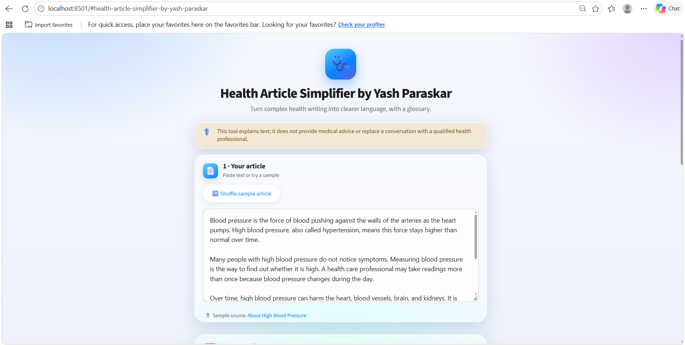
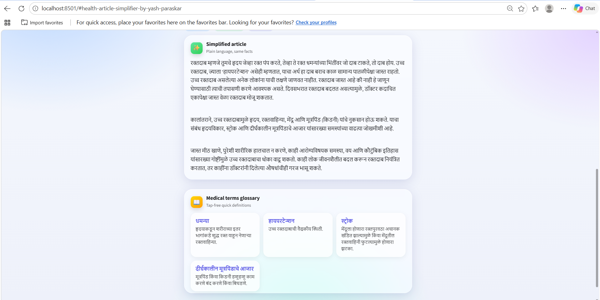

# PS60: Health Article Simplifier

A Streamlit app that rewrites pasted health articles in simpler language and
provides a plain-language glossary of medical terms. It uses Google's Gemini
API (Google AI Studio) and does not store submitted text.

This is an educational aid, not medical advice. Simplifications can be wrong;
check important health decisions with a qualified health professional.

## Requirements

- Python 3.10 or newer
- A Google AI Studio Gemini API key

## Run locally

1. Create and activate a virtual environment:

   ```powershell
   py -m venv .venv
   .\.venv\Scripts\Activate.ps1
   ```

2. Install dependencies:

   ```powershell
   python -m pip install -r requirements.txt
   ```

3. Copy `.env.example` to `.env`, add your key, and select the Gemini model
   with `GEMINI_MODEL`. Never commit `.env`.

4. Start the app:

   ```powershell
   python -m streamlit run app.py
   ```

Choose an output language, paste an article, and select **Simplify article**.
When `GEMINI_MODEL` is unset or blank, the app defaults to `gemini-2.5-flash`.
Select **Shuffle sample article** to load a different four-paragraph sample
from `sample_articles.json`. The samples are paraphrased from the CDC pages
linked with each article in the app.

## Manual testing and screenshots

Try at least five health passages in the running app. Check that facts,
numbers, and uncertainty are preserved and that glossary explanations are
clear. For example, try passages about hypertension, vaccines, insulin, MRI
scans, and dehydration. Capture screenshots of the simplified article and
glossary for your submission.

### App interface



### Simplified article and glossary



## GitHub and submission

The project is ready for a repository named `llm-ps60-<RollNo>`. Once the
repository URL is available, add it as the Git remote and push the project.
Keep API keys and private article text out of the repository and screenshots.
